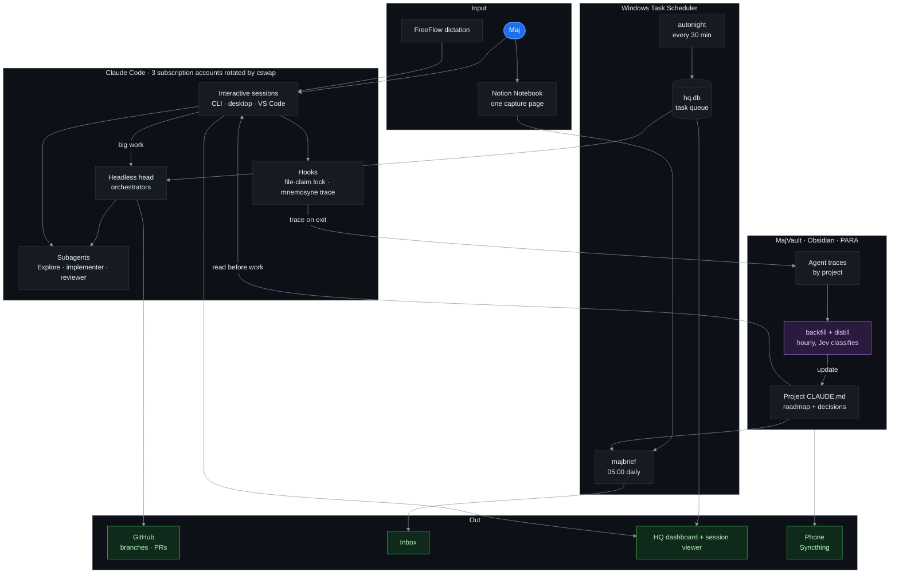

# Korent Harness

My whole agentic coding setup on one page. One Windows PC, Claude Code on three subscription accounts, an Obsidian vault as long term memory, and a few scheduled jobs that keep working while I sleep.

This is not a framework you install. It is my setup, glued to my machine. The public parts you can take and use. The private parts are listed so you see the whole picture. 🔒 means the repo is private.

## Instructions for your Claude

Copy this into Claude Code (or Codex) and it sets up the core of this harness on your machine. It asks before it installs anything.

```text
Read https://github.com/korentmaj/korent-harness and set up the core of that
harness on my machine, adapted to me. Go one step at a time, tell me what you
are about to do, and wait for my yes before you install anything or change
anything in my global config.

1. Memory vault. Clone https://github.com/korentmaj/obsidian-tracehold and run
   its setup script (setup.ps1 on Windows, setup.sh on macOS / Linux). Ask me
   where the vault should live and whether I already have an Obsidian vault
   to use instead. It needs Node.js LTS.

2. Memory protocol. Make sure my global ~/.claude/CLAUDE.md says, in a few
   lines: before project work, read <vault>/01_Projects/<Project>/CLAUDE.md
   and the last 1 to 3 traces of that project in 05_Agents/Traces. After the
   work, write durable decisions back into that project CLAUDE.md. Do not
   ask me what you can look up in the vault first.

3. Traces. Check that the SessionEnd hook from step 1 is in my Claude Code
   settings and writes a trace. Run one short test session and show me the
   trace file it wrote.

4. Seeing sessions. Offer to install
   https://github.com/korentmaj/simple-agent-session-manager so I can see
   which sessions are working and which wait for me.

5. Plugins. Offer superpowers (https://github.com/obra/superpowers) and
   Context7. Install only what I say yes to.

Skip the parts that only make sense on Maj's PC: autonight, majbrief, cswap
account rotation and the HQ dashboard. At the end, list every file you
created or changed and how to undo each one.
```

## How it fits together



**The loop in one paragraph.** Every session starts by reading the project's `CLAUDE.md` in the vault, so it knows what earlier sessions decided. While it works, a hook locks the files it edits, so two parallel agents never write the same file. When it ends, another hook writes a trace of what it did into the vault. Every hour those traces get classified and distilled back into the project's `CLAUDE.md`. The next session starts smarter. At night autonight picks tasks from `hq.db` and runs them on whichever account still has quota. At 05:00 a brief lands in my inbox.

## The parts

### Memory

| Part | What it does | Repo |
|---|---|---|
| MajVault | Obsidian vault in PARA folders. Each project has a `CLAUDE.md` that is its memory. ~3700 agent traces so far. | 🔒 private, it is my brain |
| Obsidian Tracehold | The vault pattern as a template: read before working, write a trace after. Works with Claude Code, Codex, Copilot. | [korentmaj/obsidian-tracehold](https://github.com/korentmaj/obsidian-tracehold) |
| mnemosyne | Exports session transcripts. My fork adds `vault trace`, which the SessionEnd hook calls. | [korentmaj/mnemosyne](https://github.com/korentmaj/mnemosyne) (fork of AletheiaResearch) |
| Notion Notebook | One page where I dump everything. Every 30 min Jev sorts each line into Task, Event, Note or Idea. | 🔒 private |

### Running agents

| Part | What it does | Repo |
|---|---|---|
| cswap (claude-swap) | Three Claude subscriptions, rotated by 5 hour and 7 day usage. Big work burns the other accounts first. | third party |
| autonight | Night coding engine. Task Scheduler calls `dispatch.mjs` every 30 min, it picks a task from `hq.db` and runs it. | 🔒 private |
| Head orchestrators | Headless Opus sessions on another account that spawn their own subagents for work that needs 3+ agents or 30+ minutes. | 🔒 private (skills) |
| file-claim hook | PreToolUse hook. Locks a file to the session editing it, denies other sessions for 10 min after the last edit. | 🔒 private |
| Subagents | `Explore` (read only), `implementer` (well specified change), `reviewer` (adversarial review, runs the tests). | 🔒 private |

### Seeing what is going on

| Part | What it does | Repo |
|---|---|---|
| Session viewer | Local dashboard + TUI. Which sessions are working, which wait for me, answer them inline. Stdlib Python. | [korentmaj/simple-agent-session-manager](https://github.com/korentmaj/simple-agent-session-manager) |
| HQ dashboard | The cockpit. Accounts, running jobs, sessions, briefs, vault health, skills, projects. Also a read API for agents. | 🔒 private |

### Daily life

| Part | What it does | Repo |
|---|---|---|
| majbrief | Morning brief. Reads vault, Notion, calendar and news, mails me a plan for the day. Runs on the subscription, no API bill. | [korentmaj/majbrief](https://github.com/korentmaj/majbrief) (generic version), live one 🔒 |
| FreeFlow | Hotkey, talk, polished text appears in any app. Most of my prompts start as voice. | [korentmaj/freeflow](https://github.com/korentmaj/freeflow) |
| Thunderbird AI reply | Button in Thunderbird that drafts a reply with Claude Code on my own machine. | [korentmaj/thunderbird-ai-reply](https://github.com/korentmaj/thunderbird-ai-reply) |

### Skills and plugins

Plugins I run every day: [superpowers](https://github.com/obra/superpowers) (brainstorm, plan, TDD, verify), ponytail (keeps agents lazy in the good way), Context7 (current library docs instead of memory), TypeScript LSP, TypeSafe (typed AI judgments), Figma.

## My skill list

About 85 skills, synced across all three accounts. Most are collected from other people and I use them as they are. Credit goes to their authors.

**Written by me** (🔒 for now, tied to my vault and paths)

| Skill | What it does |
|---|---|
| `korent-harness` | Lets an agent understand and inspect this whole setup: accounts, autonight, sessions, brief, vault, dashboard API. |
| `majvault` | Search, read and write my Obsidian vault. Used before an agent says "I don't know". |
| `delegate` | Forks a big task to another account (same transcript, same model) so the other accounts burn first. |
| `by7-orchestrator` | Starts headless Opus head orchestrators on the other accounts that spawn their own subagents. |
| `maj-tone` | Writes mail and posts in my voice, built from ~1700 of my own messages. This README went through it too. |
| `transkripcija` | Audio or video to a speaker labelled Markdown transcript, Slovenian and English. |

<details>
<summary><b>Engineering workflow</b> (most from <a href="https://github.com/mattpocock/skills">mattpocock/skills</a>)</summary>

`grill-me` · `grill-with-docs` · `grilling` · `handoff` · `teach` · `research` · `wizard` · `wait-what` · `to-questionnaire` · `prototype` · `codebase-design` · `domain-modeling` · `improve-codebase-architecture` · `resolving-merge-conflicts` · `writing-for-agents` · `full-output-enforcement`

</details>

<details>
<summary><b>Frontend design and taste</b></summary>

`impeccable` · `design-taste-frontend` · `design-taste-frontend-v1` · `gpt-taste` · `high-end-visual-design` · `minimalist-ui` · `industrial-brutalist-ui` · `redesign-existing-projects` · `stitch-design-taste` · `image-to-code` · `imagegen-frontend-web` · `imagegen-frontend-mobile` · `brandkit` · `apple-design` · `emil-design-eng` · `pick-ui-library` · `ask-sonner` · `web-perf`

</details>

<details>
<summary><b>Animation</b></summary>

`animate` · `animate-expo` · `animation-vocabulary` · `find-animation-opportunities` · `improve-animations` · `review-animations`

</details>

<details>
<summary><b>Cloudflare</b></summary>

`cloudflare` · `wrangler` · `workers-best-practices` · `durable-objects` · `agents-sdk` · `nextjs-on-cloudflare` · `cloudflare-email-service` · `cloudflare-one` · `cloudflare-one-migrations` · `turnstile-spin` · `sandbox-sdk` · `sandbox-stable` · `sandbox-next` · `sandbox-migrate-to-next`

</details>

<details>
<summary><b>iOS and App Store Connect</b> (for the <code>asc</code> CLI)</summary>

`write-swift` · `asc-cli-usage` · `asc-workflow` · `asc-app-create-ui` · `asc-id-resolver` · `asc-signing-setup` · `asc-xcode-build` · `asc-build-lifecycle` · `asc-notarization` · `asc-testflight-orchestration` · `asc-crash-triage` · `asc-release-flow` · `asc-submission-health` · `asc-metadata-sync` · `asc-localize-metadata` · `asc-whats-new-writer` · `asc-aso-audit` · `asc-screenshot-resize` · `asc-shots-pipeline` · `asc-ppp-pricing` · `asc-subscription-localization` · `asc-revenuecat-catalog-sync` · `asc-wall-submit`

</details>

## What I would take first

If you want one thing from this: the vault loop. Read `CLAUDE.md` before work, write a trace after, distill traces back into `CLAUDE.md`. Start with [obsidian-tracehold](https://github.com/korentmaj/obsidian-tracehold). Everything else is nice to have.

Honest limits: it is Windows only, tied to my paths, and the private parts are not cleaned up for anyone else. Ask me if you want a specific piece opened.

Maj Korent · [WMinus](https://wminus.com)
